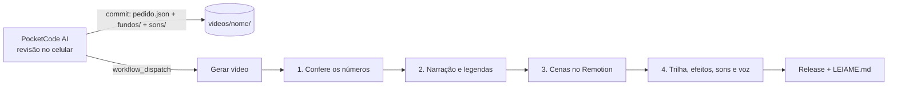

# meus-videos

**Motor de vídeos curtos do [PocketCode AI](https://github.com/cslucas106).** Os pedidos são montados e revisados no celular, pelo modo 🎬 Vídeo do app; aqui, o GitHub Actions confere os números, narra, desenha as cenas, mistura o áudio e publica o resultado num Release. Sem custo e sem nenhuma chave secreta neste repositório.

## Sumário

- [Como funciona](#como-funciona)
- [Organização do repositório](#organização-do-repositório)
- [Arquivos de cada vídeo](#arquivos-de-cada-vídeo)
- [O pedido (`pedido.json`)](#o-pedido-pedidojson)
- [Workflows](#workflows)
- [Rodar no computador](#rodar-no-computador-opcional)
- [Por que o repositório é público](#por-que-o-repositório-é-público)
- [Licenças e créditos](#licenças-e-créditos)

## Como funciona



1. **Conferência** (`motor/scripts/verifica.mjs`): todo número falado ou escrito precisa estar na tabela de dados, com fonte, link e data. Pedido que não passa não vira vídeo. As mesmas regras rodam antes no app.
2. **Mídia**: o workflow copia as imagens, fotos e sons que o app gravou; baixa as fotos que faltarem (`fotos.mjs`) e os contornos dos municípios do IBGE (`malhas.mjs`).
3. **Narração** (`narrar.py`, vozes grátis do Microsoft Edge): a duração de cada cena sai do tempo da fala, então voz e imagem ficam sincronizadas. Gera as legendas e o texto do Release.
4. **Cenas** (`motor/src/`, [Remotion](https://www.remotion.dev)): transições, legenda no estilo escolhido e números que aparecem quando a voz os fala.
5. **Áudio** (`juntar.py`): trilha gerada nota por nota (`musica.py`), efeitos (`efeitos.py`), sons de ambiente por cena e a voz por cima; a trilha abaixa um pouco quando a voz fala.
6. **Publicação**: um Release com os arquivos e o link no `LEIAME.md` da pasta do vídeo.

## Organização do repositório

| Pasta | Conteúdo |
| --- | --- |
| `videos/<nome>/` | `pedido.json` (o roteiro conferido), `fundos/` (imagens geradas `fundo-N` e fotos `foto-N`), `sons/` (sons de ambiente `som-N.mp3`) e `LEIAME.md` (título, fontes e links dos Releases). |
| `audios/<nome>/` | Pedido de narração do modo Mídia e `LEIAME.md`. |
| `imagens/<nome>/` | Imagem salva pela Galeria do modo Mídia e `LEIAME.md` com a descrição usada. |
| `videos/exemplo/` | Vídeo de teste, gerado de novo (sem Release) sempre que o motor muda. |
| `motor/` | O código: `scripts/` (Node e Python), `src/` (cenas do Remotion), `tests/` e o `package.json`. Não é preciso mexer aqui para usar. |

Os arquivos grandes (mp4, mp3, srt) ficam nos **Releases**: o Git guarda tudo para sempre e recusa arquivos acima de 100 MB. Apagar pelo app (🗑 na aba Vídeos ou na Galeria) remove o Release, a tag e a pasta do item. O teste `motor/tests/estrutura.test.mjs` confere essa organização e valida todos os pedidos a cada commit.

## Arquivos de cada vídeo

| Arquivo | Para quê |
| --- | --- |
| `video.mp4` | Vídeo pronto, com narração e trilha. |
| `video-sem-audio.mp4` | Só a imagem, para outra voz ou música. |
| `narracao.mp3` | Só a voz. |
| `legendas.srt` | Legendas frase por frase. |
| `trilha.mp3` | Só a música (quando o pedido tem trilha). |
| `capa.jpg` | Quadro da abertura, sem legenda. |
| `post.txt` | Texto pronto para postar, com fontes, créditos e hashtags (quando o pedido tem post). |

## O pedido (`pedido.json`)

Exemplo completo em [`videos/exemplo/pedido.json`](videos/exemplo/pedido.json). As regras estão em `motor/scripts/regras.mjs` (cópia idêntica em `js/video-regras.js` do PocketCode).

### Geral

| Campo | Valores |
| --- | --- |
| `formato` | `vertical` (1080×1920) ou `horizontal` (1920×1080). |
| `voz` | `pt-BR-FranciscaNeural`, `pt-BR-AntonioNeural`, `pt-BR-ThalitaMultilingualNeural`, `pt-PT-RaquelNeural`, `pt-PT-DuarteNeural`. |
| `tema` | `escuro`, `neon`, `jornal` (claro, com serifa), `natureza` ou `pop` (`motor/src/estilo.js`). |
| `livre` | `true` = roteiro livre: só entram dados informados pela pessoa e anos conferidos na Wikipédia. |
| `post` | `{"texto", "hashtags"}` para o kit de postar (os números do texto também são conferidos). Sem `post`, não há `post.txt`. |

### Som e legenda

| Campo | Valores |
| --- | --- |
| `musica` | `nenhuma`, `calma`, `animada`, `lofi`, `epica`, `suspense`, `alegre`, `eletronica`. |
| `musicaVolume` | 0 a 100 (padrão 50). |
| `efeitos` | `false`, `completo` (ou `true`), `suave`, `transicoes`, `arcade`. |
| `sonsVolume` | 0 a 100 (padrão 50), volume dos sons de ambiente. |
| `legenda` | `false`, `animada` (ou `true`), `simples`, `grande`, `caixa`. |

### Tela final

| Campo | Efeito |
| --- | --- |
| `mostrarFontes` | `true` (padrão) mostra fontes e créditos. |
| `falarFontes` | `true` faz a voz ler as instituições de origem dos dados. |
| `avisoIA` | No roteiro livre, `true` (padrão) mostra o aviso de texto escrito com IA. |

Sem fontes e sem aviso, o vídeo termina na última cena; os créditos das fotos continuam na própria cena.

### Dados

Cada dado tem `id`, `rotulo`, `valor`, `unidade`, `fonte`, `url` e `data`.
- **Conta** com outros dados: `"calculo": "(pop2022 - pop2010) / pop2010 * 100"`.
- **Informado pela pessoa**: `"manual": true` (link opcional; fonte e data obrigatórias); a tela final diz "informado por quem fez o vídeo".
- **Ano**: `"unidade": "ano"`; aparece sem ponto e só na `linhaTempo`, nunca como valor de gráfico.

### Cenas

Tipos: `titulo`, `numero`, `comparacao` (2 dados), `ranking` (3 a 10), `barras` (2 a 8), `linha` (evolução), `linhaTempo` (2 a 6 eventos com ano), `lista` (2 a 6 itens), `mapa` (estados com `uf`, ou até 30 municípios de um estado com `mun`), `icones` (porcentagem em 100 bonequinhos), `texto` e `animacao`. Toda cena tem `narracao`.

Opcionais por cena:
- `transicao`: `corte`, `zoom`, `deslizar`, `subir`.
- `imagem`: arquivo em `fundos/` (`fundo-N` ou `foto-N`).
- `foto`: `{"url", "pagina", "autor", "licenca", "fonte"}` de uma foto livre do **Wikimedia Commons**, do **Pixabay** ou da **NASA** (até 6 por vídeo). O crédito aparece na cena, na tela final, nas notas e no `post.txt`.
- `som` + `somArquivo`: som de ambiente do **Freesound** (CC0 ou CC BY, até 3 por vídeo), misturado baixinho só durante a cena, com crédito no fim.
- **Animação** (até 2 por vídeo): código escrito pela IA que passa pelas regras de `checaCodigo` (sem laços, `this`, `new`, colchetes, `window`, `fetch`…), roda antes num teste isolado (`animacao-teste.mjs`) e, no vídeo, só enxerga a API de `motor/src/animacao.js`. Se falhar, a cena vira um texto com o título.

Guia de ritmo e estilo: [`.pocketcode/skills/diretor-de-video.md`](.pocketcode/skills/diretor-de-video.md).

## Workflows

| Workflow | Quando roda | O que faz |
| --- | --- | --- |
| `video.yml` (Gerar vídeo) | Disparado pelo app; também a cada mudança em `motor/` ou no exemplo | `modo: video` gera o vídeo e o Release; `modo: storyboard` para depois da narração e publica uma foto de cada cena (Release de pré-lançamento, apagado quando o vídeo sai ou após 3 dias). |
| `voz.yml` (Gerar narração) | Disparado pelo modo Mídia | `narracao.mp3` e `legendas.srt` num Release. |
| `testes.yml` | A cada commit | Regras, estrutura do repositório, storyboard, mapas e animações (`motor/tests/`). |

Os workflows rodam dentro de `motor/` e leem os pedidos em `../videos/` e `../audios/`.

## Rodar no computador (opcional)

```bash
cd motor
npm install
npm run estudio                                   # Remotion Studio com o exemplo
node scripts/verifica.mjs ../videos/exemplo/pedido.json out/pedido.json
pip install edge-tts numpy && python scripts/narrar.py out/pedido.json out
npm run render
npm run testar                                    # testes
```

Requer Node 22, Python 3 e ffmpeg.

## Por que o repositório é público

Em repositório público, o GitHub Actions é grátis e sem limite de minutos. Aqui **não há nenhuma chave secreta**: a voz do Edge não pede chave, e o Release usa o token automático do Actions, que só vale para este repositório. As chaves de IA, do Pixabay e do Freesound ficam só no Cloudflare do PocketCode; o app grava aqui apenas o pedido aprovado e os arquivos já baixados.

## Licenças e créditos

- Código deste repositório: MIT.
- [Remotion](https://www.remotion.dev/license): grátis para pessoas físicas e empresas com até 3 pessoas.
- Trilhas e efeitos: gerados por código a cada vídeo, sem gravação de terceiros.
- Mapa do Brasil: [@svg-maps/brazil](https://www.npmjs.com/package/@svg-maps/brazil), CC BY 4.0; malhas de municípios: IBGE (creditados na tela final).
- Fotos: Wikimedia Commons (licenças livres), Pixabay (Licença Pixabay) e NASA (domínio público, exceto material de terceiros, que o app descarta). Sons: Freesound (CC0 e CC BY). Os créditos vão no vídeo, nas notas e no post.
- Vozes do Edge (edge-tts): serviço da Microsoft sem garantia; use a `narracao.mp3` com bom senso.
- Dados: cada fonte tem os próprios termos. IBGE, Banco Central e Banco Mundial permitem reutilizar citando a fonte, e o vídeo mostra as fontes no final.
